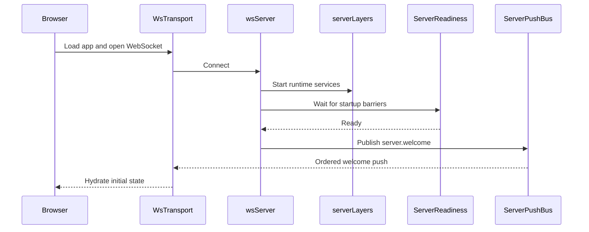
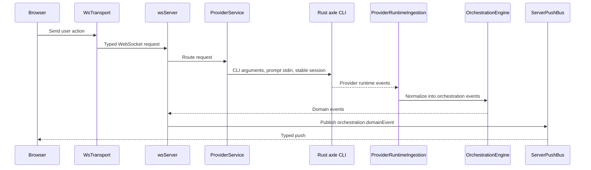
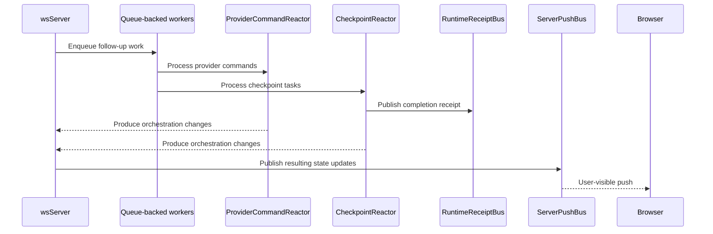

# Architecture

Axle runs as a **Node.js HTTP/WebSocket server** that serves the React client and owns projects, orchestration, events, and persistence. Its active built-in provider is the aggregated `AxleDriver`: `AxleAdapter` launches the Rust `axle` CLI and translates NDJSON events into the existing orchestration model. The standalone Codex/Claude adapters remain compatibility code; they are not registered as additional built-in drivers.

```
┌─────────────────────────────────┐
│  Browser (React + Vite)         │
│  wsTransport (state machine)    │
│  Typed push decode at boundary  │
└──────────┬──────────────────────┘
           │ ws://localhost:3773
┌──────────▼──────────────────────┐
│  apps/server (Node.js)          │
│  WebSocket + HTTP static server │
│  ServerPushBus (ordered pushes) │
│  ServerReadiness (startup gate) │
│  OrchestrationEngine            │
│  ProviderService                │
│  CheckpointReactor              │
│  RuntimeReceiptBus              │
└──────────┬──────────────────────┘
           │ Axle CLI / NDJSON over stdio
┌──────────▼──────────────────────┐
│  Rust axle agent runtime        │
└─────────────────────────────────┘
```

## Components

- **Browser app**: The React app renders session state, owns the client-side WebSocket transport, and treats typed push events as the boundary between server runtime details and UI state.

- **Server**: `apps/server` is the main coordinator. It serves the web app, accepts WebSocket requests, waits for startup readiness before welcoming clients, and sends all outbound pushes through a single ordered push path.

- **Provider runtime**: the Rust CLI owns the agent loop, provider HTTP transports, tools, approvals, and durable provider conversation. `AxleAdapter` launches it with a stable session identity and translates its NDJSON events. Server projections and the provider transcript are separate stores with distinct responsibilities.

- **Background workers**: Long-running async flows such as runtime ingestion, command reaction, and checkpoint processing run as queue-backed workers. This keeps work ordered, reduces timing races, and gives tests a deterministic way to wait for the system to go idle.

- **Runtime signals**: The server emits lightweight typed receipts when important async milestones finish, such as checkpoint capture, diff finalization, or a turn becoming fully quiescent. Tests and orchestration code wait on these signals instead of polling internal state.

## Event Lifecycle

### Startup and client connect



1. The browser boots `WsTransport` and registers typed listeners in `wsNativeApi`.
2. The server accepts the connection in `wsServer` and brings up the runtime graph defined in `serverLayers`.
3. `ServerReadiness` waits until the key startup barriers are complete.
4. Once the server is ready, `wsServer` sends `server.welcome` from the contracts in `ws.ts` through `ServerPushBus`.
5. The browser receives that ordered push through `WsTransport`, and `wsNativeApi` uses it to seed local client state.

### User turn flow



1. A user action in the browser becomes a typed request through `WsTransport` and the browser API layer in `nativeApi`.
2. `wsServer` decodes that request using the shared WebSocket contracts in `ws.ts` and routes it to the right service.
3. [`ProviderService`][8] starts or resumes a session through the registered Axle driver. The adapter supplies the stable provider session and the Rust CLI reads its persisted transcript.
4. Provider-native events are pulled back into the server by [`ProviderRuntimeIngestion`][9], which converts them into orchestration events.
5. [`OrchestrationEngine`][10] persists those events, updates the read model, and exposes them as domain events.
6. `wsServer` pushes those updates to the browser through `ServerPushBus` on channels defined in [`orchestration.ts`][11].

### Async completion flow



1. Some work continues after the initial request returns, especially in [`ProviderRuntimeIngestion`][9], [`ProviderCommandReactor`][13], and [`CheckpointReactor`][14].
2. These flows run as queue-backed workers using [`DrainableWorker`][16], which helps keep side effects ordered and test synchronization deterministic.
3. When a milestone completes, the server emits a typed receipt on [`RuntimeReceiptBus`][15], such as checkpoint completion or turn quiescence.
4. Tests and orchestration code wait on those receipts instead of polling git state, projections, or timers.
5. Any user-visible state changes produced by that async work still go back through `wsServer` and `ServerPushBus`.

[8]: ../../apps/server/src/provider/Layers/ProviderService.ts
[9]: ../../apps/server/src/orchestration/Layers/ProviderRuntimeIngestion.ts
[10]: ../../apps/server/src/orchestration/Layers/OrchestrationEngine.ts
[11]: ../../packages/contracts/src/orchestration.ts
[13]: ../../apps/server/src/orchestration/Layers/ProviderCommandReactor.ts
[14]: ../../apps/server/src/orchestration/Layers/CheckpointReactor.ts
[15]: ../../apps/server/src/orchestration/Layers/RuntimeReceiptBus.ts
[16]: ../../packages/shared/src/DrainableWorker.ts

## Execution boundary

Remote access connects a client to another Axle server; a relay does not run agents. The Rust `ExecutionTarget` abstraction currently has only `LocalExecutionTarget`, meaning commands run on the machine hosting that agent. Independent cloud execution needs a separately hosted control plane, provisioned isolated runners, durable job ownership, and artifact storage. The in-memory side-effect queues above are not a durable cloud job queue.

Authoritative runtime registration: `apps/server/src/provider/builtInDrivers.ts`.
