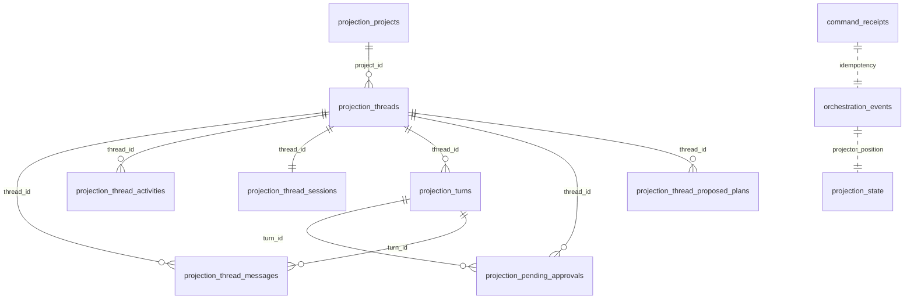

# 06 — Data Model and Lifecycle

Part of the Axle codebase-intelligence dossier (index: `CODEBASE_INTELLIGENCE_INDEX.md`). Evidence date 2026-10-13. Column lists marked **(read)** were read directly; items marked **[I]** are inferred from migration file names or Drizzle module names and should be confirmed before schema work.

Axle has **three independent persistence systems plus file-based agent state**:

| Store | Technology | Owner | Contents |
| --- | --- | --- | --- |
| Server DB | SQLite (Effect SQL) | `apps/server/src/persistence` | Event store + projections + auth + schedules state |
| Agent state | JSONL + TOML + JSON files | Rust crates, under `.axle/` (per cwd) and `AXLE_HOME` | Sessions, memory, agent profiles |
| Relay DB | Postgres via Drizzle | `infra/relay` | Device↔environment linking, DPoP proofs, APNs activity |

---

## 1. Server SQLite — event store tables

| Migration | Table | Purpose |
| --- | --- | --- |
| `001_OrchestrationEvents.ts` | `orchestration_events` | Append-only domain event log (single source of truth for orchestration) **[I]** column detail not re-read |
| `002_OrchestrationCommandReceipts.ts` | `command_receipts` | Idempotency receipts for dispatched commands (deterministic ids, e.g. `schedule:{run.id}`) |
| `003_CheckpointDiffBlobs.ts` | `checkpoint_diff_blobs` | Stored per-turn diff payloads backing diff UI |
| `004_ProviderSessionRuntime.ts` | `provider_session_runtime` | Runtime binding between a thread and a provider process/session |
| — (runtime DDL, `schedules/Service.ts:43`) | `scheduled_tasks_state` | **Single-row** state doc: `id INTEGER PRIMARY KEY CHECK (id = 1), document TEXT NOT NULL`; claim+advance is read-modify-write on that row (`Service.ts:162-172`) |

## 2. Server SQLite — projection tables (columns read from `005_Projections.ts`)

```
projection_projects(project_id PK, title, workspace_root, default_model NULL,
                    scripts_json, created_at, updated_at, deleted_at NULL)
projection_threads(thread_id PK, project_id, title, model, branch NULL,
                   worktree_path NULL, latest_turn_id NULL, created_at,
                   updated_at, deleted_at NULL)
projection_thread_messages(message_id PK, thread_id, turn_id NULL, role, text,
                           is_streaming INTEGER, created_at, updated_at)
projection_thread_activities(activity_id PK, thread_id, turn_id NULL, tone,
                             kind, summary, payload_json, created_at)
projection_thread_sessions(thread_id PK, status, provider_name NULL,
                           provider_session_id NULL, provider_thread_id NULL,
                           active_turn_id NULL, last_error NULL, updated_at)
projection_turns(row_id INTEGER PK AUTOINCREMENT, thread_id, turn_id NULL,
                 pending_message_id NULL, assistant_message_id NULL, state,
                 requested_at, started_at NULL, completed_at NULL,
                 checkpoint_turn_count NULL, checkpoint_ref NULL,
                 checkpoint_status NULL, checkpoint_files_json,
                 UNIQUE(thread_id, turn_id), UNIQUE(thread_id, checkpoint_turn_count))
projection_pending_approvals(request_id PK, thread_id, turn_id NULL, status,
                             decision NULL, created_at, resolved_at NULL)
projection_state(projector PK, last_applied_sequence INTEGER, updated_at)
```

Migration `005` also creates index `idx_projection_projects_updated_at` (115-117) and further thread/message/activity indexes that continue past line 118.

### Projection evolution migrations (file names are the evidence)

| Migration | Adds |
| --- | --- |
| `006_ProjectionThreadSessionRuntimeModeColumns` | runtime-mode columns on thread-session projection **[I]** |
| `007_ProjectionThreadMessageAttachments` | attachments on messages |
| `008_ProjectionThreadActivitySequence` | ordering sequence on activities |
| `009_ProviderSessionRuntimeMode` / `010_ProjectionThreadsRuntimeMode` / `011_OrchestrationThreadCreatedRuntimeMode` | runtime-mode propagation through the event stream |
| `012_ProjectionThreadsInteractionMode` | interaction mode (plan/build) on threads |
| `013_ProjectionThreadProposedPlans` | proposed-plan projection |
| `014_ProjectionThreadProposedPlanImplementation` | plan→implementation linkage |
| `015_ProjectionTurnsSourceProposedPlan` | turns carry their originating plan |
| `016_CanonicalizeModelSelections` (+test) | one-off data normalization for model selections |
| `017_ProjectionThreadsArchivedAt` / `018_...ArchivedAtIndex` | archive timestamp + index |
| `019_ProjectionSnapshotLookupIndexes` (+test) | snapshot query indexes |
| `020_AuthAccessManagement` / `021_AuthSessionClientMetadata` / `022_AuthSessionLastConnectedAt` | `auth_pairing_links`, `auth_sessions` lifecycle metadata |
| `023_ProjectionThreadShellSummary` / `024_Backfill...` (+test) | sidebar shell summary + backfill |
| `025_CleanupInvalidProjectionPendingApprovals` (+test) | data cleanup |
| `026_CanonicalizeModelSelectionOptions` (+test) | normalization |
| `027_ProviderSessionRuntimeInstanceId` / `028_ProjectionThreadSessionInstanceId` (+test) | provider-instance routing columns |
| `029_ProjectionThreadDetailOrderingIndexes` (+test) | detail-view ordering indexes |
| `030_ProjectionThreadShellArchiveIndexes` | shell/archive composite indexes |
| `031_AuthAuthorizationScopes` (+test) | session scopes (`orchestration:read`, `orchestration:operate`, `terminal:operate`, `review:write`, `access:read`, `access:write`, `relay:read`, `relay:write` — `packages/contracts/src/auth.ts:76-83`) |
| `032_AuthPairingProofKeyThumbprint` | DPoP-style proof-key thumbprint on pairing |

## 3. Entity relationships (verified by FK-like column names in `005` + later migration names)



There are **no declared SQL foreign keys** in migration `005` — integrity is maintained by the event pipeline (`projection_state.last_applied_sequence` tracks replay position per projector). Treat the diagram as logical, not enforced. **[V]** for the absence of `FOREIGN KEY` in the read portion; **[I]** for the logical edges named after their columns.

## 4. Agent-plane data (files, not SQL)

| Artifact | Path | Notes |
| --- | --- | --- |
| Sessions | `<cwd>/.axle/sessions/<uuid>.jsonl` | Header `{type, version, id}` validated (id must equal filename); entries `Message | CustomMessage | Compaction` (`axle_session/src/types.rs:7,19`); compaction trims older entries on load (`manager.rs:234-254`) |
| Session repair | same file | `repair_tool_protocol` drops orphan/duplicate tool results and injects `INTERRUPTED_TOOL_RESULT` (`manager.rs:371-426`) |
| Memory | under `AXLE_HOME` `memory/` directory (`launcher.ts:56`) | Global + project stores with legacy fallback; backup recovery path (`axle_memory/src/lib.rs:87-104,249-258`) |
| Agent profiles | `.axle/agents.toml` (legacy `.rivet`/`.sparky`) | Deny-unknown-fields schema; `system_prompt_fragment` injected as `<agent_profile>` (`axle_config/src/lib.rs:9-56`) |
| Launcher home layout | `AXLE_HOME` (legacy `RIVET_HOME`, `T3CODE_HOME`; homes `.Axle`, `.Rivet`, `.sparky-desktop`, `.t3`) | Creates `userdata/`, `userdata/logs/{provider,terminals}`, `userdata/attachments`, `userdata/secrets`, `caches/`, `worktrees/`, `memory/`, `launcher/` (`launcher.ts:41-58`) |

## 5. Relay Postgres (drizzle, `infra/relay/migrations/postgres`)

Baseline `20260527044716_baseline` creates (**read**):

| Table | Notable indexes (read) |
| --- | --- |
| `relay_agent_activity_rows` | `idx_..._updated (updated_at)` |
| `relay_delivery_attempts` | `idx_..._environment (environment_id, thread_id, created_at)` |
| `relay_dpop_proofs` | `idx_..._expires_at (expires_at)` |
| `relay_environment_credentials` | `(environment_id, revoked_at)`, `(environment_id, environment_public_key, revoked_at)` |
| `relay_environment_links` | `(environment_id, revoked_at)` |
| `relay_live_activities` | `(user_id)` |
| `relay_mobile_devices` | `(user_id)` |

Later: `20260601225421` adds `relay_mobile_devices.label`; `20260603035812` adds `relay_managed_endpoint_allocations`; `20260706061126` adds `relay_mobile_devices.bundle_id` + `aps_environment`.

**Lifecycle design note:** credentials and links are soft-revoked via `revoked_at` rather than deleted — **[I]** consistent with reconnection flows in `EnvironmentLinker`/`EnvironmentConnector`.

## 6. Lifecycle, retention, and deletion

- **Threads**: soft-delete via `deleted_at` on projections; archive via `archived_at` (migrations `017/018/030`); delete/archive commands exist (`thread.delete`, `thread.archive`, `thread.unarchive` — `contracts/src/orchestration.ts:557-573`).
- **Turns**: state machine `requested_at → started_at → completed_at` with checkpoint metadata; uniqueness enforced per `(thread_id, turn_id)` and `(thread_id, checkpoint_turn_count)`.
- **Messages**: `is_streaming` flag flips when the assistant message completes (event `thread.message.assistant.complete`, `orchestration.ts:770`).
- **Agent sessions**: never auto-deleted; compaction trims content by rewriting the file; Ctrl+C saves the session on interactive exit (`axle_cli/src/main.rs:1133-1157`).
- **Terminals**: 5 000-line scrollback, 128 retained sessions (`terminal/Manager.ts`).
- **Relay**: soft revocation; delivery attempts accumulate per environment/thread; DPoP proofs expire via `expires_at` index.
- **Analytics**: retention lives in Convex deployment, not this repo. **[U]**

## 7. Migrations strategy

- **Server**: ordered TypeScript modules executed by the persistence layer; some migrations ship with their own tests (`016`, `019`, `024`, `025`, `026`, `027_028`, `029`, `031`) — a good pattern to copy. Projections are rebuildable: replay from `orchestration_events` and per-projector `projection_state.last_applied_sequence` (the replay path is `OrchestrationSnapshotQuery`/`ProjectionPipeline`).
- **Relay**: drizzle-kit directories with `snapshot.json` + `migration.sql`; applied by the deploy script (`infra/relay/scripts/deploy.ts`).
- **Drift risk**: projection tables are created by `CREATE TABLE IF NOT EXISTS` DDL; there is no schema hash/guard, so a field added to the event payload without a projection migration silently lands only in `payload_json`. **[I]**

## 8. Transactions, concurrency, idempotency

| Concern | Mechanism | Evidence |
| --- | --- | --- |
| Duplicate command delivery | `command_receipts` with deterministic command ids | migration `002`; schedules use `schedule:{run.id}` |
| Concurrent schedule ticks | single-row claim/advance on `scheduled_tasks_state` | `Service.ts:43,162-172` |
| Session append races | file lock around append; in-memory state update after | `axle_session/src/manager.rs:259-282` |
| Compaction vs. append | full-file rewrite (`rewrite_session_file`) — **the riskiest operation in the agent store**; a crash mid-rewrite is the reason the repair path exists | `manager.rs:530+`; `repair_tool_protocol` 371-426 |
| Projection replay position | `projection_state.last_applied_sequence` per projector | migration `005:107-111` |
| SQLite journaling mode / busy timeout | **[U]** not established | — |

## 9. Sensitive data handling

- Secrets directory exists (`userdata/secrets`, `launcher.ts:53`) for provider credentials; `electron-store` is also used by desktop. **[I]** exact secret-file formats not verified.
- Memory writes reject secret-shaped content (`axle_memory/src/lib.rs:61-84`) — prevents the agent from persisting keys it sees in source.
- Auth material lives in `auth_pairing_links` / `auth_sessions` with scope columns (migrations `020/031`) and a pairing proof-key thumbprint (`032`); the relay stores environment public keys and revocable credentials (Postgres tables above).
- Documents in this dossier never copy credential values; only variable names appear.
